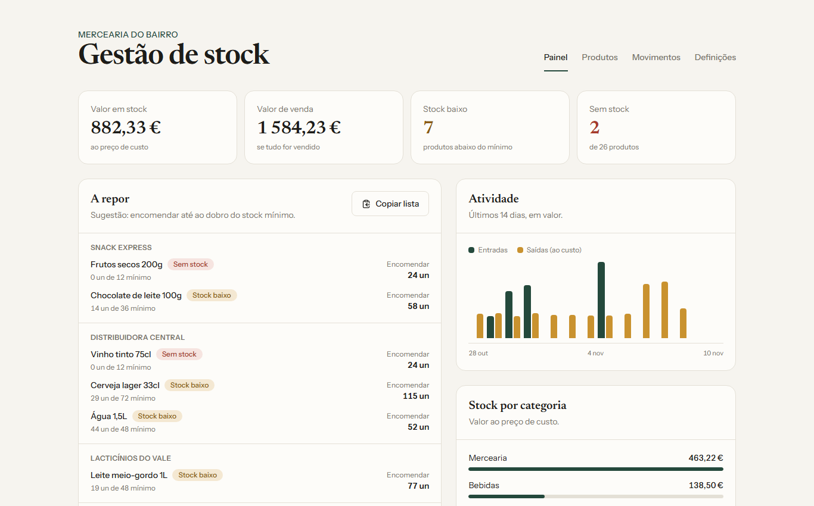

# Gestão de Stock

Controlo de inventário para pequenos comércios (mercearias, lojas, oficinas, restaurantes):
saber o que há em armazém, o que está a acabar e o que encomendar. Projeto 4 de uma série de
6 ferramentas para pequenos negócios.



## Funcionalidades

- **Painel** com valor do stock, produtos abaixo do mínimo, atividade dos últimos 14 dias e stock por categoria
- **Lista de encomenda** agrupada por fornecedor, com quantidade sugerida e botão para copiar
- Produtos com código (SKU), categoria, fornecedor, unidade, custo, preço de venda, margem e stock mínimo
- Movimentos de **entrada**, **saída** e **contagem** de inventário, com histórico completo por produto
- Pré-visualização do stock resultante antes de registar um movimento
- Pesquisa, filtros por categoria e estado (stock baixo, sem stock) e exportação para CSV (abre no Excel)
- Categorias e fornecedores geridos nas definições

### Regras de negócio

- **O stock nunca fica negativo**, mesmo com dois pedidos em simultâneo
- O stock não é um campo editável: é a **soma dos movimentos**, por isso nunca fica dessincronizado do histórico
- Uma contagem de inventário regista a diferença como um movimento de ajuste, não apaga o histórico
- O custo de uma entrada passa a ser o custo atual do produto
- Produtos são arquivados em vez de apagados, para preservar os movimentos
- Categorias e fornecedores com produtos não podem ser apagados

## Stack

| Camada | Tecnologia |
|---|---|
| Interface | React 19, Vite, Tailwind CSS 4 |
| API | Node.js, Express 5 (REST) |
| Base de dados | PostgreSQL |

A proteção contra stock negativo está na base de dados, num *trigger* que bloqueia o produto e
confere a soma antes de aceitar cada movimento:

```sql
IF atual + NEW.quantidade < 0 THEN
  RAISE EXCEPTION 'Stock insuficiente: disponível %', atual USING ERRCODE = '23514';
END IF;
```

## Como correr

Requisitos: Node.js 20+ e PostgreSQL 15+.

```bash
# 1. Base de dados
createdb gestao_stock
psql -d gestao_stock -f server/db/schema.sql
psql -d gestao_stock -f server/db/seed.sql   # dados de demonstração (opcional)

# 2. API
cd server
cp .env.example .env     # ajusta o utilizador e a palavra-passe
npm install
npm start                # http://localhost:3004

# 3. Interface (noutro terminal)
cd client
npm install
npm run dev              # http://localhost:5173
```

## API

| Método | Rota | Descrição |
|---|---|---|
| GET | `/painel` | Indicadores, lista a repor, atividade e stock por categoria |
| GET | `/produtos` | Lista com stock e estado (`?arquivados=true`) |
| GET | `/produtos/:id` | Detalhe com os últimos movimentos |
| POST, PUT | `/produtos`, `/produtos/:id` | Cria e edita (aceita `stock_inicial`) |
| DELETE | `/produtos/:id` | Arquiva |
| GET | `/movimentos` | Histórico (`?produto_id=&tipo=&limite=`) |
| POST | `/movimentos` | Entrada, saída ou ajuste (`novo_stock`) |
| GET, POST, PUT, DELETE | `/categorias` | Categorias |
| GET, POST, PUT, DELETE | `/fornecedores` | Fornecedores |

## Estrutura

```
gestao-stock/
  client/   interface React
  server/   API Express, esquema SQL e dados de demonstração
```
